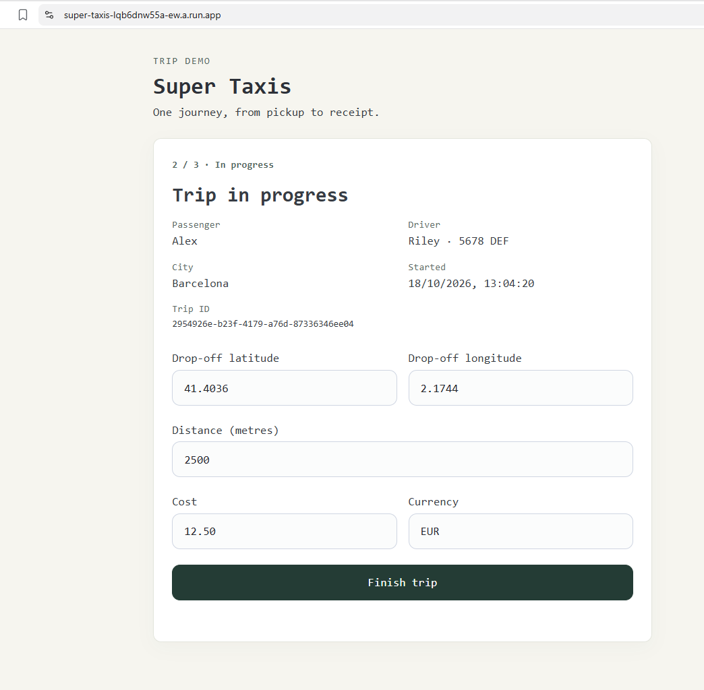
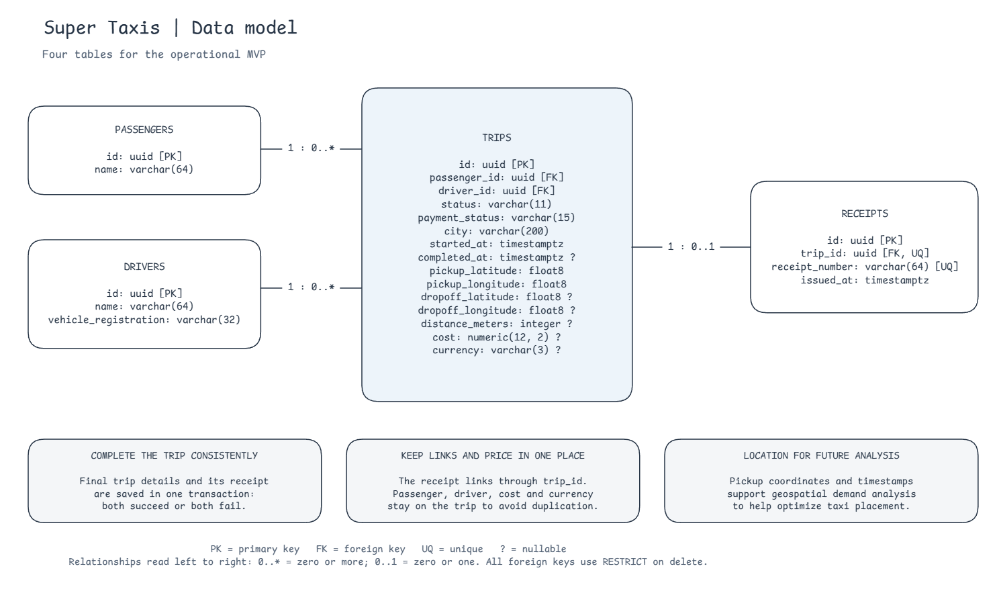
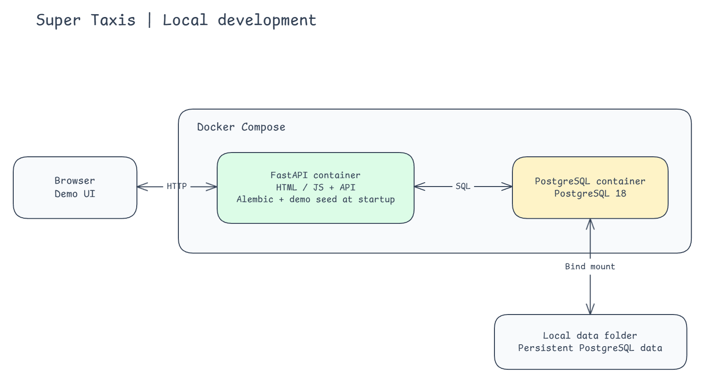
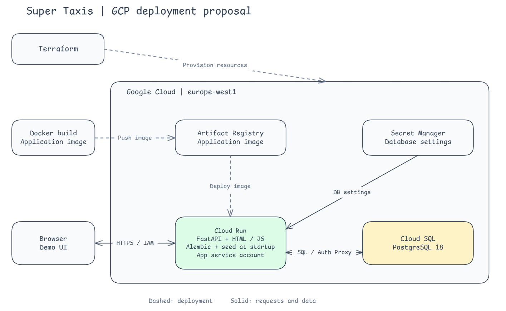
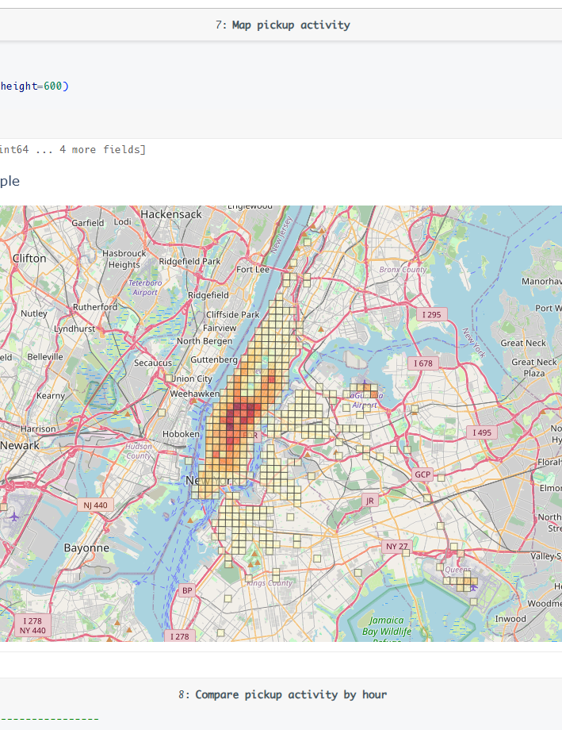

# Super Taxis

A small taxi platform MVP: **start a trip, finish it, and generate its receipt**. The application runs on Google Cloud, with a separate Databricks notebook demonstrating spatial analysis of taxi pickups.

## Try the live demo

**[Open Super Taxis](https://super-taxis-lqb6dnw55a-ew.a.run.app/)** — no installation or sign-in required. The application uses fictional, shared demo data.

1. Choose a passenger and driver, enter the city and pickup coordinates, and **start a trip**.
2. Enter the drop-off coordinates, distance, cost and currency, then **finish the trip**.
3. View the **automatically generated receipt**, or start another trip.



The form calls the FastAPI endpoints and waits for each response before advancing. **Trip completion and receipt creation happen in one database transaction:** both succeed or both roll back. Repeating the finish request returns the original trip details and receipt; it does not create another receipt.

The same API can be explored through its **[interactive documentation](https://super-taxis-lqb6dnw55a-ew.a.run.app/docs)**.

## Data model

Four tables keep the operational model small: **passengers, drivers, trips and receipts**. A driver's vehicle registration is stored on the driver for this MVP.

[](docs/diagrams/data-model.excalidraw)

- **Pickup/drop-off coordinates and timestamps** capture where and when journeys happen, enabling later spatial analysis and comparisons by time of day.
- **Relationships and price have one home.** The trip holds the passenger, driver, cost and currency. A receipt refers to its trip through a unique `trip_id`, avoiding duplicate links and amounts that could disagree.
- **PostgreSQL enforces consistency.** Foreign keys, unique constraints and check constraints protect relationships, coordinate ranges, monetary values and trip completion details. Money uses a decimal type.

## Backend components

| Component | What it contributes here |
| --- | --- |
| **PostgreSQL** | Transactional storage for trips and receipts, with ACID transactions and database constraints. |
| [**SQLAlchemy**](app/models/) | Python ORM models define tables and relationships; sessions provide queries and transaction boundaries. |
| [**Pydantic**](app/schemas/) | Explicit request and response contracts validate coordinates, amounts and other input before the endpoint processes it. |
| [**Alembic**](migrations/) | Versioned migrations create and evolve the database schema through explicit upgrade/downgrade steps. |
| [**FastAPI**](app/routers/) | Focused endpoints to list demo participants, start/read/finish trips and retrieve receipts, with generated OpenAPI documentation. |
| [**HTML, JavaScript and Pico CSS**](app/static/) | A small browser interface served by FastAPI, with no separate frontend build or framework. |
| [**uv**](pyproject.toml) | Python dependency management, with `uv.lock` recording resolved versions for reproducible installation. |

## Local development with Docker

**Docker Compose runs the application and PostgreSQL as separate containers.** The app waits for the database to become healthy, runs migrations, inserts the two demo passengers and drivers, then starts FastAPI. Seeding is safe to repeat.

[](docs/diagrams/local-architecture.excalidraw)

With Docker running and GNU Make installed, run from the repository root:

```sh
cp .env.example .env
make start-app
```

Before starting, set `POSTGRES_DATA_PATH` in `.env` to your preferred local data folder; the example uses a Windows path. Open **[localhost:8005](http://localhost:8005/)**. PostgreSQL is available locally on port **5435**.

**Database files persist outside the container**, so `make stop-app` stops the services without deleting trip data. `make upgrade-db` applies pending Alembic migrations; `make downgrade-db` reverses the latest migration.

## Cloud deployment with Terraform

The same application image is deployed in **Google Cloud's `europe-west1` region**. Cloud Run runs the app; Cloud SQL provides managed PostgreSQL. The deployed demo accepts public HTTPS requests without a Google login.

[](docs/diagrams/cloud-architecture.excalidraw)

| Service | Role |
| --- | --- |
| **Artifact Registry** | Stores the Docker application image built locally and pushed with `docker push`. |
| **Cloud Run** | Runs FastAPI and serves the frontend, using the image's immutable digest. The configured revision scales from zero to one instance. |
| **Cloud SQL** | Hosts PostgreSQL 18 with backups and deletion protection. The app connects through the Cloud SQL Auth Proxy integration. |
| **Secret Manager** | Supplies the database settings at startup through the application's service account. |

**[Terraform](infrastructure/) declares the resources and their configuration.** `terraform plan` compares the configuration with deployed state; `terraform apply` creates or updates the required resources. An unchanged configuration produces no planned changes.

Deployment follows three steps:

1. Provision the supporting resources with `app_image = null`.
2. **Build and push the Docker image** to Artifact Registry.
3. Set `app_image` to the published digest and apply Terraform to create or update Cloud Run.

Cloud startup loads the database settings, runs **Alembic migrations and the demo seed**, then starts FastAPI. Docker Compose coordinates the local containers; Terraform manages the cloud resources.

To deploy your own copy, install Terraform 1.11 or later (below 2.0), the Google Cloud CLI and Docker, and use a GCP project with billing enabled. Copy [the example inputs](infrastructure/terraform.tfvars.example) to `infrastructure/terraform.tfvars`, set your project and database password, and leave `app_image = null` for the first apply. The `credentials_file` setting points to your local Google login file. These local files are ignored by Git. After authenticating as described below, run from the repository root:

```sh
terraform -chdir=infrastructure init
terraform -chdir=infrastructure plan
terraform -chdir=infrastructure apply
```

Configure Docker authentication with `gcloud auth configure-docker europe-west1-docker.pkg.dev`. Build and push the image, replacing `PROJECT_ID` with your project:

```sh
docker build --platform linux/amd64 -t europe-west1-docker.pkg.dev/PROJECT_ID/super-taxis/app:v1 .
docker push europe-west1-docker.pkg.dev/PROJECT_ID/super-taxis/app:v1
```

Set `app_image` to `europe-west1-docker.pkg.dev/PROJECT_ID/super-taxis/app@sha256:DIGEST`, using the digest printed by the push, then plan and apply again. `terraform -chdir=infrastructure output app_url` prints the public URL. Future app updates follow the same build, push and digest-update steps. Cloud SQL continues to run when Cloud Run scales to zero.

## Spatial analytics with Databricks

**Operational requests and analytical workloads have different needs.** Trip updates need short, predictable transactions; spatial joins and historical aggregations can scan much larger datasets. A separate analytical copy lets those workloads evolve without putting their query load on the operational database.

This demo uses **Databricks Free Edition**, separate from the GCP deployment. Its [source notebook](analytics/notebooks/pickup_demand.py) creates the managed Delta table **`workspace.super_taxis.nyc_trips_2015`** from **10,000 historical NYC yellow taxi trips from January 2015**. It does not ingest the live PostgreSQL database.



The notebook uses **native Databricks spatial functions**:

1. **`ST_Point`** converts pickup longitude/latitude into spatial points.
2. **`ST_Transform`** projects them into UTM zone 18N, where coordinates are measured in metres.
3. Dividing X and Y by 500 and rounding down assigns every pickup to a **500 × 500 metre cell**. Spark counts pickups per cell and by New York local hour.
4. **`ST_GeomFromWKT`** creates the square polygons, and **`ST_AsGeoJSON`** exports them for the map. Only the small, aggregated results are converted to Pandas for Plotly rendering.

**Darker cells show more observed pickups in the sample.** This demonstrates how location and time can inform taxi placement; it does not measure road congestion or forecast demand.

The [preparation script](analytics/prepare_sample.py) retrieves original coordinate records from [NYC Open Data](https://data.cityofnewyork.us/Transportation/2015-Yellow-Taxi-Trip-Data/2yzn-sicd/about_data). It selects 10,000 valid records with a fixed seed from a systematic time subset across January. **The sample is exploratory, not statistically representative of the whole month.** Distances are converted from miles to metres, costs retain their original USD amounts, and links to the two demo passengers and drivers are synthetic. A generated manifest records the query, seed, counts and file hashes.

**[The Databricks bundle](analytics/databricks.yml) makes deployment repeatable:** it uploads the notebook and sample files, and creates a manually triggered serverless job. With uv installed, prepare the sample from the repository root:

```sh
uv run python analytics/prepare_sample.py
```

After authenticating the Databricks CLI with the `super-taxis` profile, deploy and run from `analytics/`:

```sh
databricks bundle deploy --profile super-taxis
databricks bundle run pickup_demand --profile super-taxis
```

The bundle targets the demo workspace. To use another workspace, update `workspace.host` in `analytics/databricks.yml` and authenticate against that workspace. Generated sample files and local deployment state are excluded from Git.

## Development tooling

- **[Repository skills](.agents/skills/)** provide reusable instructions: the Excalidraw skill keeps fonts, labels and connectors consistent and includes a diagram validator; the wrap-up skill guides concise Conventional Commit messages.
- **[The gcloud MCP configuration](.codex/config.toml)** lets a coding assistant inspect and manage GCP resources through the Google Cloud CLI. Its [launcher](scripts/start_gcloud_mcp.ps1) pins the MCP version and uses a repository-specific credential folder under `.cache/gcloud/`.
- **The Databricks CLI** uses the `super-taxis` profile for browser-based authentication, notebook uploads and bundle deployment/runs. Credentials stay outside Git.

To create or renew the repository's Google login, run from the repository root in PowerShell:

```powershell
$env:CLOUDSDK_CONFIG = Join-Path $PWD '.cache/gcloud'
gcloud auth login --update-adc
```

**Terraform reads the credentials file directly**, using `credentials_file` from `terraform.tfvars`; no authentication environment variables need setting before Terraform commands. The MCP launcher sets its own credential folder automatically. For direct `gcloud` commands or Docker pushes in a new terminal, set `CLOUDSDK_CONFIG` as above so they use the same repository login. Credentials are excluded from Git and Docker builds; access permissions still come from GCP IAM.
